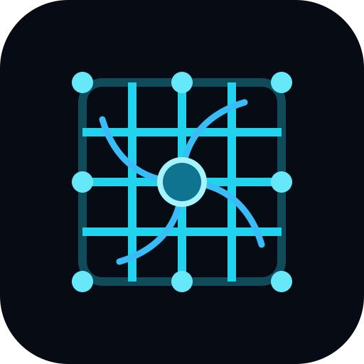

# CL1 Neural Labs



**Research operating environment for neural-culture simulation, MEA visualization, experiments, analytics, and controlled CL1 SDK integration.**

> Build 0.4.0 · CL1NL-20261013-001 · Developer: **ArkansasIo** · License: **MIT**

A research and development studio for exploring Cortical Labs CL1-style biological neural computing through simulation, neural-signal visualization, closed-loop experiments, stimulation workflows, analytics, datasets, and database-backed research records.

> **Important:** This repository contains software simulations and research tooling. The included simulator is not a biological culture and does not reproduce the full behavior of living neurons. The CL1-compatible server endpoints are development/simulation interfaces and must not be represented as direct physical-hardware control unless an explicitly implemented and validated hardware adapter is used.

## Project goals

- Explore biological neural-network computation through reproducible software experiments.
- Model a 64-channel microelectrode-array (MEA) environment.
- Visualize neural activity in 2D and 3D.
- Study spikes, bursts, stimulation, firing rates, functional connectivity, and network dynamics.
- Run closed-loop experiment concepts including Pong, associative conditioning, and maze navigation.
- Provide a software boundary for future integration with the official Cortical Labs CL API.
- Preserve experimental data in CSV and MySQL-compatible schemas.
- Provide a research library and developer playground.

## Current architecture

```
React / TypeScript UI
        |
        +-- MEA 2D / 3D visualization
        +-- Experiments
        +-- Stimulation workbench
        +-- Analytics
        +-- Code playground
        +-- Research library
        +-- Database / datasets
        |
        v
NeuralCultureSimulator
        |
        +-- 64-channel neural activity
        +-- synaptic-weight model
        +-- spike/stimulation events
        +-- waveform buffers
        +-- firing-rate analysis
        +-- burst dynamics
        |
        +----------------------+
        |                      |
        v                      v
Local simulation         CL1-style server interface
                         REST + WebSocket
```

## Repository structure

```
.
├── database/
│   ├── datasets/
│   ├── cl1_database_connector.py
│   ├── mysql.config.json
│   ├── schema.sql
│   └── seed_dataset.sql
├── public/
│   ├── visualiser/
│   └── research / visualization assets
├── src/
│   ├── components/
│   ├── data/
│   ├── simulation/
│   └── types/
├── server.ts
├── package.json
├── tsconfig.json
└── vite.config.ts
```

## Major software modules

### User interface

The React application in `src/App.tsx` provides:

- 2D MEA visualization
- 3D MEA visualization
- experiment suite
- stimulation workbench
- analytics suite
- code playground
- legacy visualizer
- recording controller
- research library
- hardware/settings interface
- database and dataset hub

### Neural simulation

`src/simulation/neuralCulture.ts` implements the primary software neural-culture model. It maintains:

- 64 channels
- channel excitability
- refractory state
- baseline voltage
- synaptic weights
- waveform ring buffers
- spike counters
- firing-rate estimates
- burst state
- recent spike/stimulation events
- simulation listeners

### Experiments

Current experiment modules include:

- DishBrain-style Pong
- associative conditioning
- maze navigation
- neural analysis workflows

These are computational experiments inspired by biological-neural research, not claims that the simulator is equivalent to living wetware.

### CL1-style server

`server.ts` exposes:

- `GET /_/config`
- `GET /api/status`
- `POST /api/stim`
- WebSocket `/_/ws/overview`

The development server models a 64-channel stream, including spike/stimulation flags and simulated waveform values.

## Data layer

The MySQL schema in `database/schema.sql` models:

- cultures
- cellular subpopulations
- electrodes
- recording sessions
- spike events
- stimulation events
- closed-loop experiments
- DSP filter configurations

Example datasets are stored under `database/datasets/`.

The Python connector in `database/cl1_database_connector.py` provides configuration and dataset-loading/export scaffolding.

## Development

The project uses:

- React 19
- TypeScript
- Vite
- Bun/npm-compatible package metadata
- Express
- WebSocket
- Three.js
- Tailwind CSS
- Lucide React
- Motion

Install dependencies:

```bash
bun install
```

Run the Vite development application:

```bun run dev```

Build:

```bun run build```

Type-check:

```bun run lint```

The `dev` script starts the Express/WebSocket simulator with Vite middleware on port 3000. `dev:vite` starts Vite directly. The API contract is documented in [docs/API-CONTRACTS.md](docs/API-CONTRACTS.md), with the REST surface captured in [openapi.yaml](openapi.yaml).

## Research workflow

A recommended workflow is:

1. Define an experiment.
2. Configure the simulated culture.
3. Run the experiment with fixed parameters.
4. Record spikes and stimulation events.
5. Analyze firing rates, bursts, connectivity, and other metrics.
6. Export the resulting dataset.
7. Store metadata in the database schema.
8. Compare repeated runs.
9. Only then compare results with external biological datasets.

## Physical CL1 integration

The repository is structured so a future adapter can translate real CL1 recordings into the same internal data model used by the simulator.

The intended boundary is:

```
Official CL API
      |
      v
CL1 adapter
      |
      v
Common neural data model
      |
      +--> analysis
      +--> visualization
      +--> recording
      +--> experiments
      +--> database
```

Do not infer physical-device access from the existence of the simulator endpoints. Hardware integration requires the official CL software/API, compatible hardware, appropriate authorization, and validated safety procedures.

## Safety and research integrity

- Never send stimulation commands to physical biological hardware without validated limits and an independent safety review.
- Keep simulator experiments clearly labeled as simulated.
- Preserve provenance for imported datasets.
- Do not present synthetic neural activity as experimental biological measurements.
- Record software version, experiment parameters, dataset source, and timestamp for reproducibility.
- Follow applicable institutional, biological, electrical, and research-ethics requirements for physical experiments.

## Boot and branding

- [Linux-style boot loader](docs/BOOT-LOADER.md)
- [CL1 Neural Labs logo](public/branding/cl1-neural-labs-logo.svg)
- [Build identity](docs/BUILD-IDENTITY.md)

## Documentation

- [Repository completeness audit](docs/MISSING-FILES-AUDIT.md)
- [Remaining files and implementation plan](docs/REMAINING-FILES-PLAN.md)
- [API contracts](docs/API-CONTRACTS.md)
- [OpenAPI specification](openapi.yaml)
- [Architecture](docs/ARCHITECTURE.md)
- [Development](docs/DEVELOPMENT.md)
- [CL1 Integration](docs/CL1-INTEGRATION.md)
- [Experiments](docs/EXPERIMENTS.md)
- [Data Model](docs/DATA-MODEL.md)
- [Research Notes](docs/RESEARCH.md)

## Status

This is an active research/prototyping repository. The simulator, visualization system, experiment modules, datasets, and database model are present. Physical CL1 integration remains a distinct hardware/API integration stage.

## License

This project is licensed under the [MIT License](LICENSE). Third-party dependencies and the official Cortical Labs SDK/API remain subject to their own licenses and terms.

## Research and verification guides

- [Implementation and validation roadmap](docs/IMPLEMENTATION-ROADMAP.md)
- [Reproducible research protocol](docs/REPRODUCIBLE-RESEARCH.md)
- [Verification matrix](docs/TEST-MATRIX.md)
- [Development operations runbook](docs/OPERATIONS-RUNBOOK.md)
- [Experiment plan templates](research/EXPERIMENT-PLAN-TEMPLATES.md)
- [Machine-readable experiment statement example](research/examples/experiment-statement.example.json)

These guides distinguish implementation work from test evidence and scientific validation. Synthetic outputs must remain labeled as synthetic; software simulator behavior does not prove physical CL1 compatibility or biological equivalence.
