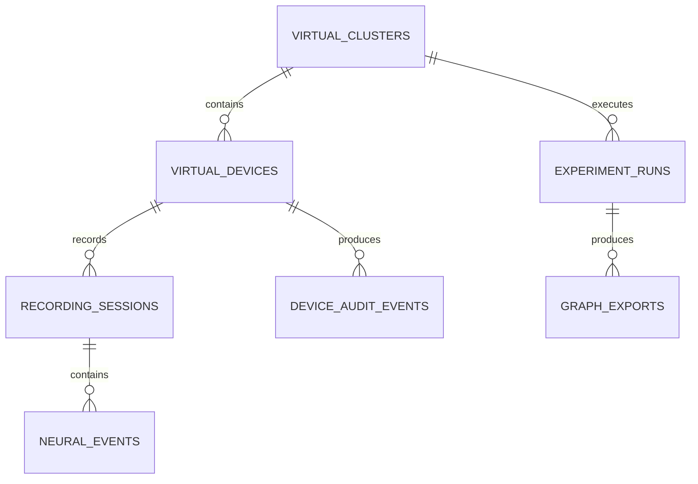

# Cluster Server and Database Design

The virtual cluster has a REST control plane and a MySQL/MariaDB-compatible persistence model.

## Services
- UI: port 3000
- Python cluster API: port 3001
- MySQL/MariaDB: port 3306

## API
- GET /api/cluster
- POST /api/cluster/connect
- POST /api/cluster/pause/{slot}
- POST /api/cluster/resume/{slot}
- GET /api/database/tables
- GET /api/database/{table}

## Data model

Every run carries a source class such as simulated, dataset_replay, sdk_simulator, or physical_adapter. Synthetic output must never be labeled as biological/live-device data.

The SQL schema does not grant physical-device access. Any physical adapter remains a separate implementation boundary.