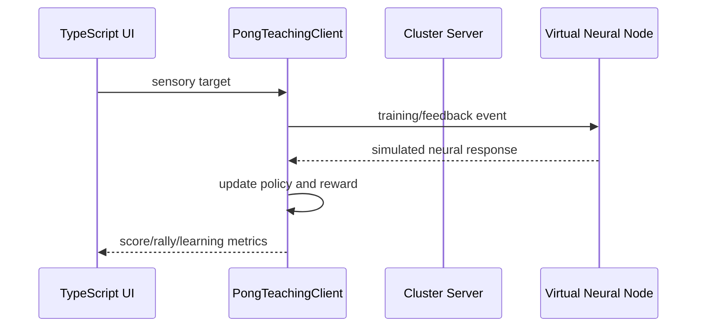

# TypeScript Cluster Client

The TypeScript client is the frontend SDK for the virtual CL1 cluster server.

## Modules

- `src/client/clusterClient.ts` — typed REST client and polling.
- `src/client/teachingClient.ts` — closed-loop Pong teaching state.
- `src/client/index.ts` — public client exports.
- `src/components/VirtualPongTeaching.tsx` — teaching UI.

## Server contract

The client consumes:

- `GET /api/cluster`
- `POST /api/cluster/connect`
- `POST /api/cluster/pause/{slot}`
- `POST /api/cluster/resume/{slot}`
- `GET /api/database/tables`
- `GET /api/database/{table}`

## Pong teaching loop

The teaching client currently records virtual feedback locally. It does not claim that a biological culture learned the policy. The next adapter can connect the same interface to the simulator's neural events or the official SDK simulator.

## Client design rules

- All server payloads are typed.
- Server errors become exceptions.
- Base URL is configurable for local or remote development.
- Polling is explicitly stoppable.
- No physical-device commands are hidden inside UI components.
- Experiment provenance remains explicit.
