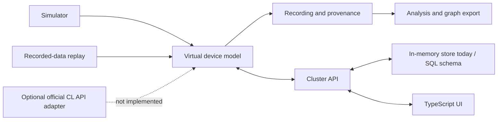
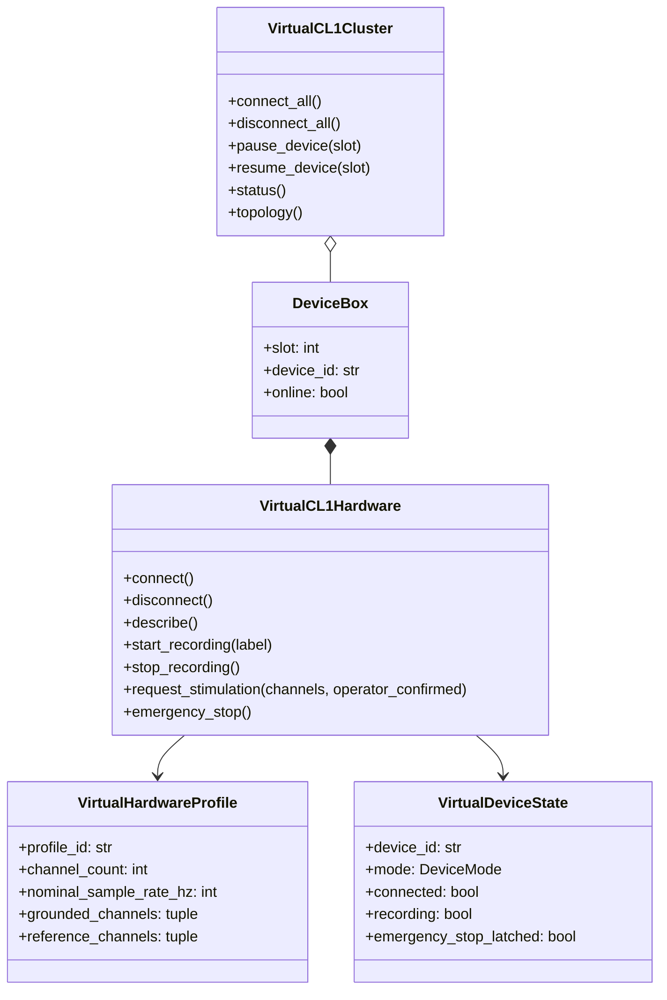

# Virtual Hardware Engineering Package

This directory contains conceptual software schematics and UML for the virtual device model. These are not electrical drawings, PCB files, or validated physical CL1 internals.

## System block schematic

## UML class view

## Measurement and wiring caveat

The repository models a 64-channel namespace and an 8×8 visualization grid. Those are software profile assumptions and must not be interpreted as physical connector pins or verified electrode coordinates. Physical power, PCB, connector, isolation, and ADC schematics require manufacturer-authorized documentation and qualified hardware engineering.

## Safety and provenance

Virtual stimulation is an audit event only and is never dispatched to a physical device. The software emergency stop is not a physical safety circuit. Every future adapter must label whether results are simulated, replayed, imported, or live.
